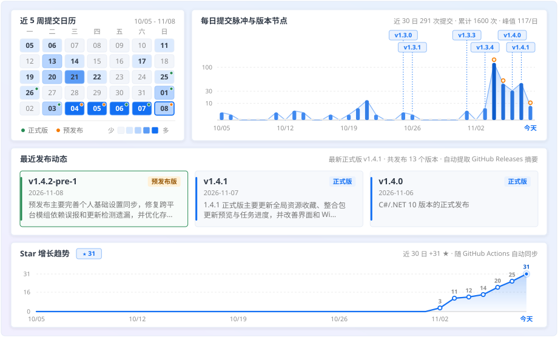

<div align="center">


# PCL Living Fork

源自 [Plain Craft Launcher (PCL)](https://github.com/Meloong-Git/PCL)、基于 **C# / .NET 10** 独立演进的现代化 Minecraft 启动器

[](https://github.com/DDZmumo/PCL-Living-Fork/releases/latest)
[](https://github.com/DDZmumo/PCL-Living-Fork/actions/workflows/build.yml)
[](https://dotnet.microsoft.com/download/dotnet/10.0)
[](https://github.com/DDZmumo/PCL-Living-Fork/releases)
[](https://qm.qq.com/q/MX1RivlHeE)

[下载 1.4.2 正式版](https://github.com/DDZmumo/PCL-Living-Fork/releases/tag/v1.4.2) ·
[CNB 国内镜像](https://cnb.cool/ddzmumo/PCL-Living-Fork/-/releases) ·
[更新说明](https://github.com/DDZmumo/PCL-Living-Fork/releases/tag/v1.4.2) ·
[历史版本](https://github.com/DDZmumo/PCL-Living-Fork/releases) ·
[问题反馈](https://github.com/DDZmumo/PCL-Living-Fork/issues) ·
[加入 QQ 群](https://qm.qq.com/q/MX1RivlHeE)

</div>

当前正式版为 **1.4.2**，可从上方 GitHub 或 CNB 镜像下载。

---

## 项目简介

**PCL Living Fork（PCLLF，原 LivingPCL）** 是由 [DDZmumo](https://github.com/DDZmumo) 独立维护的 Minecraft 启动器。项目最初源自 [Plain Craft Launcher (PCL)](https://github.com/Meloong-Git/PCL)，在完成全量 **C# / .NET 10** 现代化架构迁移的过程中，曾以 [PCL-CE](https://github.com/PCL-Community/PCL-CE) 作为同源迁移的工程示例与部分结构参考。

目前，PCLLF 与现代版 PCL-CE 虽然**同源且采用同一代底层技术栈（C# + .NET 10 + WPF）**，但在**工程模块划分、配置与数据契约、任务生命周期以及核心功能矩阵上已形成较大差异**。在延续原生丝滑动效与目录兼容的同时，PCLLF 围绕**全局资源收藏与本地管理、模组依赖图谱与启动前补全、整合包三方差异更新、环境还原点与存档自动备份、跨版本个人习惯同步**以及**原生深浅色昼夜外观**构建了独立的功能闭环，让日常游玩与折腾整合包都更省心 (｡•̀ᴗ-)✧

> **使用前请注意**
> - **独立项目定位**：PCLLF 与 **PCL 官方版**、**PCL-CE** 均为各自独立维护的不同项目，内部实现、配置契约与版本号互不相同；遇到问题或有功能建议请在[本仓库 Issues](https://github.com/DDZmumo/PCL-Living-Fork/issues) 反馈或[加入 QQ 交流群](https://qm.qq.com/q/MX1RivlHeE)，**请勿向 PCL 官方或 PCL-CE 仓库提交本项目的任何问题** (´-ω-｀)
> - **Minecraft API 与 CurseForge 第三方 API 均已获批**：正式发行版内置本项目自有 Client ID 与正式 API Key，开箱即用（接口可用性以后续平台授权及服务政策为准）。

### 与 PCL 原版及 PCL-CE 的架构对比

| 维度 | 官方 PCL | PCL Living Fork (PCLLF) | PCL-CE（.NET 10 版） |
| --- | --- | --- | --- |
| **主体语言** | `VB.NET` 主程序 + 少量 C# 库 | 全量 `C#`（旧 VB 源码已退役归档） | 全量 `C#` |
| **目标运行时** | `.NET Framework 4.8` | `.NET 10`（含 `net48 → .NET 10` 自动升级桥） | `.NET 10` |
| **界面与交互** | WPF 自有控件与动效，逻辑集中于页面后台 | WPF，保留原生动效手感，内置深浅色实时切换、昼夜背景与独立透明度 | WPF，部分页面引入 MVVM（`ViewModel`）与界面服务抽象 |
| **核心工程结构** | 主程序、`PCLCS`、`MeloongCore` | `Main`、`PCLCS`（业务引擎/控制器）、`Presentation`（控件/动效表现层）、`MeloongCore.Shared` | 主程序、`PCL.Launcher.Core`、`PCL.Core.Wpf`、`PCL.Core` |
| **配置与数据契约** | `Setup.ini` 与注册表存储 | 完整兼容原有 `Setup.ini` 与游戏目录；微软登录使用 `_LF` 独立注册表键隔离 | 自建 IoC 生命周期、`JSON / YAML` 配置服务与独立 Profile 模型 |
| **演进方向与重心** | 官方主线基线与快照功能 | **严守数据/交互兼容 + 整合包更新、依赖图谱、还原点、备份与个人习惯闭环** | 通用基础设施抽离、核心与 UI 严格解耦及社区化扩展 |

- **同源同栈的迁移参考**：PCLLF 与现代版 PCL-CE 具有共同的 PCL 血统，且均演进至 **C# + .NET 10 + WPF** 技术栈；在 PCLLF 推进 C# 转换与运行时升级期间，PCL-CE 提供了重要的现代化迁移示例与局部结构参考。
- **独立演进的架构差异**：PCLLF 选择了**“保留原有数据格式与操作直觉，按业务引擎与表现层逐步解耦”**的务实路线，重点深耕整合包三方更新、模组依赖预检、环境还原点与存档保护等自研功能链；而 PCL-CE 则更侧重于底层 IoC 容器、新配置体系与通用核心隔离。两者在代码结构与业务契约上已显著分化。

## 功能亮点

### 游戏资源与模组管理
- **全局资源收藏**：顶栏收藏区沿用下载区的搜索、分类与列表界面，收藏整个在线项目；下载、版本资源管理与收藏页同步状态，同一平台项目的不同文件和版本只保留一条记录。已匹配在线项目的模组、资源包和光影包可直接从本地列表收藏。
- **游戏资源管理**：在启动器内直接打理存档、截图、模组、资源包、光影包和投影/原理图，保留 PCL 原生列表、多选与动效；资源包与光影包支持在线更新，CurseForge 地图下载后自动归档至 `saves\PCLLFWorldDownload` 并解压安装，避免覆盖同名存档。
- **资源直接删除**：确认后直接删除本地资源；升级后自动清空各游戏目录和共享缓存中旧版的 `PCL/ResourceRecycle`，不再提供资源回收站。
- **模组依赖检查**：以圆角图标关系图直观展示模组的前置、被依赖关系与冲突；网络超时或平台未提供精确声明时自动回退参考本地声明，并缓存依赖树以加速后续打开。
- **加载器匹配核查**：识别 Fabric、Forge、NeoForge 及旧版 Forge 的实际加载声明，减少旧整合包残留模板造成的误报；不匹配模组在列表中标红提醒，内置组件自动归组展示。
- **启动前依赖管理**：主页“上次游玩”上方可随时开关依赖检查与自动补全。启动前先列出必需前置，已禁用且兼容的模组可直接启用，缺失文件则通过原生下载任务一键补齐后再启动。

### 整合包维护与环境保护
- **整合包更新**：支持从本地文件或 CurseForge / Modrinth 更新已识别的整合包，按“新增、更新、移除、保留个人修改”清晰分类预览；半途取消时也会等待文件处理与必要回滚收尾后再解除版本占用。
- **还原点**：支持手动或在更新前保存 Minecraft、加载器、模组与配置快照，改坏环境时可整套恢复，且**不会回退当前存档的游玩进度**（手动还原点独立保留，不计入自动清理上限）( •̀ ω •́ )✧
- **存档备份**：游戏正常退出后及更新 Minecraft 前自动备份世界，可在存档卡片下展开查看、恢复和设置自动备份保留份数（手动备份同样独立保留）。
- **备份与还原点删除**：确认后永久删除，释放不再被其他还原点使用的数据；升级后自动清理旧 `deleted` 目录。
- **备份存储位置**：可在“设置 → 其他 → 世界备份与环境还原点”打开文件夹选择窗口，选择专用空文件夹（如 `E:\PCLLF-Backups`，不能直接选择盘根目录）；已有数据复制并校验后才切换路径，再清理旧目录。
- **测试副本与崩溃对照**：想加模组试水时可一键克隆当前版本，在版本选择中按来源折叠收纳；若游戏发生崩溃，会自动对照上次正常运行后的环境变化，并可联动还原点快速恢复。
- **整合包导出与模式**：支持附带启动器导出、设置版本隔离策略，并提供仅保留必要入口的整合包界面模式。

### 游玩体验与个性化
- **继续上次的世界**：主页卡片与存档管理页可直接通过 Quick Play 进入上次游玩的 Java 版存档（主页卡片可在“个性化 → 主页”中关闭）。
- **主页更多设置**：默认收起模组依赖与最近存档面板，勾选后通过 PCL 动画滑出。面板内的依赖检查和自动补全默认开启，收起面板不会停用它们。
- **工具百宝箱**：提供今日人品、内存优化、游戏垃圾清理与自定义文件下载。今日人品按本地日期和设备标识固定计算，重复点击不重新抽取；保留低分、零分和系统时间变化提示，未移植原版隐藏主题解锁。
- **个人游戏习惯**：按类别跨版本同步基础按键、鼠标、视场角、视角摇晃和音量，编辑后显式保存；版本跟随全局时锁定编辑，不跟随时可独立保存此版本设置；按键管理支持搜索、同键占用检查与重新绑定，换新包也不必重头调键位 ( ´ ▽ ｀ )ﾉ
- **浅色 / 深色外观与昼夜背景**：可在“设置 → 个性化”中即时切换浅色与深色主题，内置蓝白水晶角色背景会随主题自动切换白天与夜晚姿态；窗口、面板和背景图片的不透明度各自独立调节，不淡化文字与图标。自定义主题色等解锁功能请[赞助原作者龙腾猫跃](https://meloong.com/afd/a/LTCat)获取官方快照版 ♪(^∇^*)

## 运行环境与更新说明

| 项目 | 说明 |
| --- | --- |
| **运行环境** | `1.4.0` 及后续正式版基于 **C# / .NET 10 (Windows x64)** 构建。公开发布仅提供精简版 `EXE`、`ZIP` 与 `SHA256SUMS.txt`（均不含运行时），运行或自动升级前请先安装 [.NET 10 Desktop Runtime (x64)](https://dotnet.microsoft.com/download/dotnet/10.0)。 |
| **历史版本** | 旧版 `1.3.4`、`1.3.5-pre-3` 基于 `.NET Framework 4.8` 运行，旧 VB 源码已退役归档；有需要可从 [历史 Releases](https://github.com/DDZmumo/PCL-Living-Fork/releases) 按对应说明下载。 |
| **更新源与通道** | 国内入口为 [CNB Releases](https://cnb.cool/ddzmumo/PCL-Living-Fork/-/releases)。启动器更新默认使用 CNB 源，可在设置或更新提示中切换为 GitHub 源；默认仅接收正式版，也可开启“正式版 + 预发布版”通道。 |
| **数据与账号兼容** | 升级时完整保留原有 `PCL`、`.minecraft`、游戏目录及原文件名（兼容旧 `LivingPCL2-Re` 更新入口）。微软登录使用带 `_LF` 后缀的独立注册表键，避免与其他分支互相覆盖令牌；同目录运行时共用 `PCL\Setup.ini`。 |

## 更新日历与 Commit 日历

<div align="center">

<a href="https://github.com/DDZmumo/PCL-Living-Fork/releases">
  <picture>
    <source media="(prefers-color-scheme: dark)" srcset="https://raw.githubusercontent.com/DDZmumo/PCL-Living-Fork/refs/heads/codex/readme-calendar/docs/assets/calendar-dark.svg">
    <source media="(prefers-color-scheme: light)" srcset="https://raw.githubusercontent.com/DDZmumo/PCL-Living-Fork/refs/heads/codex/readme-calendar/docs/assets/calendar-light.svg">
    
  </picture>
</a>

</div>

## 自行编译

当前源码使用 **.NET 10 SDK** 与 Windows Desktop / WPF 工具链（构建旧版兼容交接 EXE 还需安装 Visual Studio / Build Tools 的 MSBuild 与 .NET Framework 4.8 编译工具）。在 Windows PowerShell 中运行：

```powershell
git submodule update --init --recursive
dotnet restore .\PCL-Living-Fork.Modern.slnx
.\scripts\Build-Release.ps1 -Slim
```

- 本机构建默认显示 `dev_edition`；公开发布构建需显式使用 `-Slim` 和 `-OfficialRelease`。
- 源码不包含实际 Client ID 或 API Key，本地可通过环境变量 `PCL_MS_CLIENT_ID`、`PCL_CURSEFORGE_API_KEY` 提供配置，构建时会加密嵌入。
- 相关工程文档：
  - [现代构建与测试说明](docs/BUILDING_MODERN.md)
  - [公开发布约定](docs/PUBLISHING.md)
  - [外观与启动器更新通道](docs/theme-and-update-channels.md)

## 来源与许可

- **原作与上游**：原作作者为 **龙腾猫跃** 及 PCL 原项目贡献者，原作版权归 **成都瓜皮龙科技有限公司** 所有。本项目以 [Plain Craft Launcher (PCL)](https://github.com/Meloong-Git/PCL) `2.14.0.0` 为起点独立演进。
- **迁移参考与来源**：在完成全量 **C# / .NET 10** 现代化架构迁移与部分兼容实现的过程中，本项目以社区版 [PCL-CE (PCL Community Edition)](https://github.com/PCL-Community/PCL-CE) 作为同源迁移工程示例与结构参考，感谢 **PCL-Community** 及相关贡献者的开源工作。
- **许可与署名**：本项目完整保留 PCL 原作、PCL-CE 参考实现及各第三方组件的署名、版权声明与对应分发/开源许可。

- [上游 PCL 仓库](https://github.com/Meloong-Git/PCL) · [PCL-CE 仓库](https://github.com/PCL-Community/PCL-CE) · [来源与版权声明](NOTICE.md) · [许可与使用指南](LICENCE) · [爱发电支持原作者](https://meloong.com/afd/a/LTCat)

PCLLF 确认原创的独立源码采用 **[Mozilla Public License 2.0（MPL-2.0）](LICENSE)**，仓库根目录提供完整协议，范围见 [文件清单](licenses/MPL-COVERED-FILES.txt)。PCL 继承代码、混合来源及第三方组件保留各自许可，详见 [原 PCL 许可](LICENCE)、[第三方声明](THIRD-PARTY-NOTICES.md) 与 [许可审计](docs/licensing-audit.md)。
