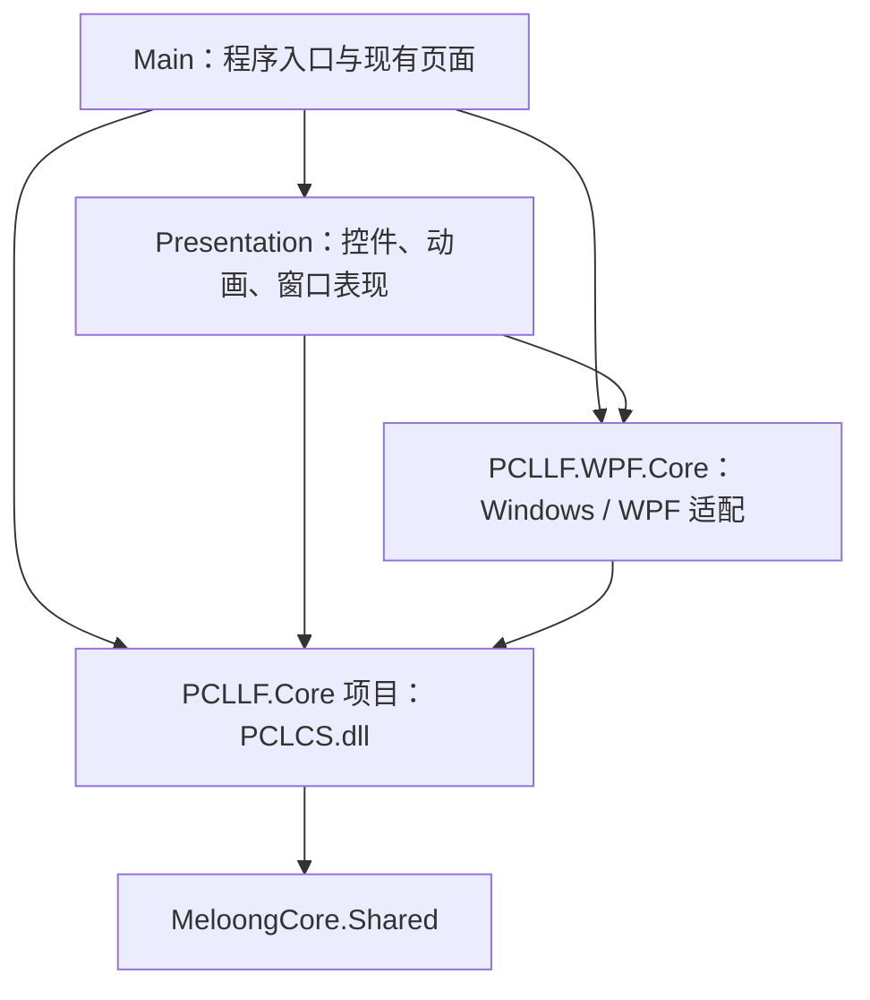

# Core 与 WPF 的程序集边界

当前产品保留 WPF，将业务代码与 Windows/WPF 适配代码独立编译。此拆分为整套新 WPF UI 接入提供基础；现有页面仍是行为对照与回归宿主。新界面的设计与整体验收独立推进，本次拆分不改变页面布局、账号存储、游戏目录或文件事务策略。

## 项目与依赖方向



| 工程 | 框架 / 程序集 | 源码职责 |
| --- | --- | --- |
| [Core](../modern/Core/PCLLF.Core.csproj) | `net10.0` / `PCLCS.dll` | `PCLCS` 下的模型、规则、启动与下载引擎、设置、任务、文件事务 |
| [WPF 适配](../PCLLF.WPF.Core/PCLLF.WPF.Core.csproj) | `net10.0-windows` / `PCLLF.WPF.Core.dll` | `PCLLF.WPF.Core` 下的页面控制器、WPF 契约、图像解码及 Windows 服务 |
| [Presentation](../modern/Presentation/PCLLF.Presentation.Modern.csproj) | `net10.0-windows` / `PCLLF.Presentation.dll` | `presentation` 与 `modern/Presentation/NativeWpf` 的控件、主题、动画和旧窗口流程 |
| [Main](../modern/Main/PCL-Living-Fork.Modern.csproj) | `net10.0-windows` / `LivingPCL.dll` | WPF 入口、业务宿主装配、页面与原生事件兼容层 |

保留 `PCLCS` 命名空间及 Core 程序集名，避免把组织调整扩大为数据与资源迁移。Windows/WPF 类型移入 `PCLLF.WPF.Core.dll`，不提供旧程序集的全类型二进制兼容承诺；外部按反射定位这些类型的工具应按新归属加载。当前 Main、Presentation 和测试均显式引用适配工程。

`PCLLF.WPF.Core` 位于仓库根目录，工程和对应源码按 Downloads、Instances、Resources 等领域一起归入该目录。历史 net48 工程通过源码链接保留原合并编译图；现代 Core 工程不包含这些适配源码。许可清单随文件移动更新，既有文件的来源与许可保持不变。

Core 不允许引用 Main、Presentation、WPF 适配层或 WindowsDesktop。WPF 适配层只使用公开 Core API，不借助 `InternalsVisibleTo` 访问内部实现。现有白盒测试单独取得 `PCLLF.Migration.Tests` 的内部可见性，从而对实际产品 DLL 保留既有回归检查。

两个原有跨层调用边界现在明确为公开契约：

- `LegacyMinecraftListOrder.SortByComparison` 保留原选择顺序、同值顺序和消耗输入列表的行为，供实例引擎和列表适配器共同使用。
- `InstanceResourcePackageRules.OpenRead(Stream, bool)` 统一 ZIP 条目名称解码；默认随 archive 关闭输入流，`leaveOpen: true` 将流生命周期留给调用者。入口不替代调用者的路径、条目名和读取大小检查。

## 当前仍存在的宿主约束

这一步隔离了程序集依赖，尚未提供独立的完整启动器应用服务。

- `ModLaunch` 仍拥有启动选项、登录任务、进程与 Watcher 等静态状态。`CreateLaunchHost` 已按原顺序逐项装配，字段表达式和状态来源保持一致。
- `LegacyLaunchHost`、`PackUpdateFlowHost` 等仍通过委托访问既有任务、选中实例、确认窗口和页面刷新。部分入口要求 UI 线程；新 UI 不能把这些调用直接搬到任意后台线程。
- Presentation 及 WPF 控制器含 `FrameworkElement`、页面元素和旧导航语义。新 UI 应按功能选择复用适配器或重新实现视图，不把这些类型带入 Core。
- Core 内仍有 Windows 注册表类型、Win32 激活与路径兼容操作。`net10.0` 表示不依赖桌面框架，并非所有方法都支持其他操作系统。

后续整套新 UI 的接入需要确定启动会话、账号、实例选择与任务状态的所有者，再按职责缩小宿主接口。每一项状态应只有一个真实来源，避免新旧界面各自保存一份并通过刷新回调同步。应用服务的提取不需要先改变现有登录、下载和文件操作策略。

## 必须保持的行为

- 账号仍使用现行注册表隔离与事务规则，`Setup.ini`、游戏目录、备份位置和用户偏好保持兼容。
- 任务取消后，等待实际写入、流关闭、回滚及 worker 收尾完成，才能释放实例占用；界面关闭或进度停止不等于业务结束。
- 实例切换不改变正在执行操作的目标；游戏退出后的备份、个人设置与 Quick Play 收尾仍以真实进程状态为准。
- 四个 Core 嵌入资源继续由 `PCLCS.dll` 持有；Main 的 WPF pack URI、WithEvents 事件绑定和原生资源保持现有规则。
- 完整新 UI 上线时需整体核对功能入口、键盘操作、深浅色、最小窗口尺寸、任务进度、错误反馈和取消恢复，不能仅凭编译通过替代验收。

详细行为契约见 [文件任务与导航](file-task-progress-and-navigation.md)、[账号存储](microsoft-account-storage.md)、[整合包更新](modpack-update-ownership.md)和 [主题与更新](theme-and-update-channels.md)。

## 验证入口

```powershell
dotnet build PCL-Living-Fork.Modern.slnx --configuration Debug -nr:false
dotnet run --project tests/PCLLF.Migration.Tests --configuration Debug --no-build
dotnet run --project tests/PCLLF.Modern.Wpf.Tests --configuration Debug --no-build -- $PWD
dotnet run --project tests/PCLLF.Native.Facade.Tests --configuration Debug --no-build
```

纯业务测试现在引用 Core 工程，避免测试用源码副本与产品程序集脱节。`foundation` 组约束 Core 依赖和资源归属；WPF 组件测试核对适配库单向引用、真实图像解码和资源原始字节；Native facade 使用实际 Main 与新依赖图验证页面、任务和业务适配。

普通本地测试使用自有临时数据。真实冷启动与升级 smoke 仍要求其声明的隔离 CI 环境，不能通过伪造环境变量运行。GUI 组件、冷启动、真实账号、游戏启动和发布包的证据分别报告，命令存在不表示某次提交已通过这些检查。
