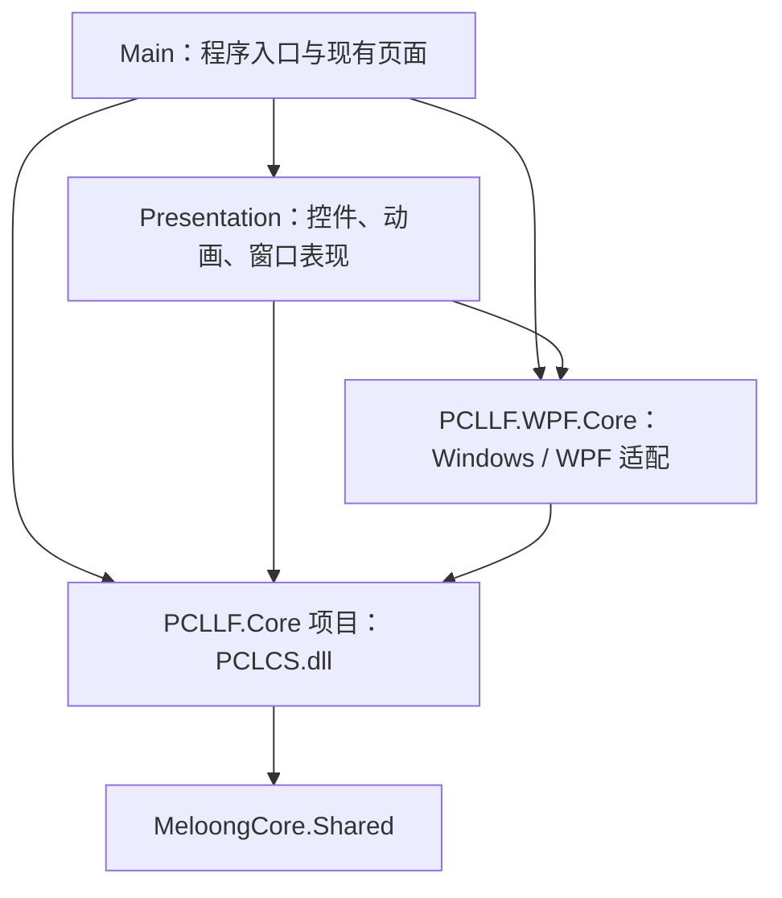

# Core 与 WPF 的程序集边界

当前产品保留 WPF，将业务代码与 Windows/WPF 适配代码独立编译。此拆分为整套新 WPF UI 接入提供基础；现有页面仍是行为对照与回归宿主。新界面的设计与整体验收独立推进，本次拆分不改变页面布局、账号存储、游戏目录或文件事务策略。

## 项目与依赖方向



| 工程 | 框架 / 程序集 | 源码职责 |
| --- | --- | --- |
| [Core](../modern/Core/PCLLF.Core.csproj) | `net10.0` / `PCLCS.dll` | `PCLCS` 下的模型、规则、启动与下载引擎、设置、任务、文件事务 |
| [WPF 适配](../PCLLF.WPF.Core/PCLLF.WPF.Core.csproj) | `net10.0-windows` / `PCLLF.WPF.Core.dll` | `PCLLF.WPF.Core` 下的页面控制器、WPF 契约、图像解码及 Windows 服务 |
| [Presentation](../modern/Presentation/PCLLF.Presentation.Modern.csproj) | `net10.0-windows` / `PCLLF.Presentation.dll` | `presentation` 与 `modern/Presentation/NativeWpf` 的控件、主题、动画和旧窗口流程 |
| [Main](../modern/Main/PCL-Living-Fork.Modern.csproj) | `net10.0-windows` / `LivingPCL.dll` | WPF 入口、业务宿主装配、页面与原生事件兼容层 |

保留 `PCLCS` 命名空间及 Core 程序集名，避免把组织调整扩大为数据与资源迁移。Windows/WPF 类型移入 `PCLLF.WPF.Core.dll`，不提供旧程序集的全类型二进制兼容承诺；外部按反射定位这些类型的工具应按新归属加载。当前 Main、Presentation 和测试均显式引用适配工程。

`PCLLF.WPF.Core` 位于仓库根目录，工程和对应源码按 Downloads、Instances、Resources 等领域一起归入该目录。历史 net48 工程通过源码链接保留原合并编译图；现代 Core 工程不包含这些适配源码。许可清单随文件移动更新，既有文件的来源与许可保持不变。

Core 不允许引用 Main、Presentation、WPF 适配层或 WindowsDesktop。WPF 适配层只使用公开 Core API，不借助 `InternalsVisibleTo` 访问内部实现。现有白盒测试单独取得 `PCLLF.Migration.Tests` 的内部可见性，从而对实际产品 DLL 保留既有回归检查。

两个原有跨层调用边界现在明确为公开契约：

- `LegacyMinecraftListOrder.SortByComparison` 保留原选择顺序、同值顺序和消耗输入列表的行为，供实例引擎和列表适配器共同使用。
- `InstanceResourcePackageRules.OpenRead(Stream, bool)` 统一 ZIP 条目名称解码；默认随 archive 关闭输入流，`leaveOpen: true` 将流生命周期留给调用者。入口不替代调用者的路径、条目名和读取大小检查。

## 应用服务与状态归属

[应用服务](../PCLCS/Application)在 Core 内编译，由 Main 的 [组合入口](../modern/Main/Application/LauncherApplicationServices.cs)绑定既有模型、引擎和平台接口。新 WPF 界面使用 `LauncherApplicationServices.Launch`、`Accounts`、`Instances` 和 `Tasks` 四个职责接口；不再分别保存启动、账号或选择状态，也不需要直接配置大型 `LegacyLaunchHost`。

| 职责 | 唯一状态来源 | 应用接口与兼容入口 |
| --- | --- | --- |
| 当前启动 | `LaunchApplicationService.Runtime` 中的选项、固定目标、Java、参数、编码、启动任务、进程和 Watcher 引用 | `ILaunchApplicationService<TOptions>` 提供启动、取消和只读快照；`ModLaunch` 同名成员转为转接属性 |
| 登录会话 | `AccountApplicationService.Runtime` 中的主登录及四种登录 Loader；其真实输入、输出和状态仍由 Loader/认证引擎维护 | `IAccountApplicationService<TInput>` 提供显式输入验证、登录、取消、退出和不含凭据的元数据快照 |
| 当前实例与目录 | `InstanceSelectionApplicationService.Runtime` 的当前实例、目录缓存；有效目录仍经 Minecraft 引擎处理整合包模式与配置规则 | `IInstanceSelectionApplicationService<TInstance>` 提供受占用检查的选择命令与变更事件；旧 setter 复用原引擎副作用顺序 |
| 任务登记与观察 | `TaskApplicationService.RuntimeTasks` 的真实 Loader 集合，以及每个 Loader/Worker 自己的执行状态 | `ITaskApplicationService` 返回绑定真实对象的观察句柄；`ModLoader.LoaderTaskbar` 转接到同一个集合 |

账号持久化仍由现有 `Settings`/注册表事务负责，应用服务不另存令牌、账号清单或已登录标志。显示名称来自当前登录方式；快照只包含方式、名称、任务元数据和由原存储推导的状态，不包含原始登录输入、令牌或异常正文。退出登录与取消启动的顺序提取为共享动作，现有页面与新应用入口调用同一份实现，原有失败提示继续留在表现层。

启动准入在修改活动会话前检查重入、正在启动及未结束的实际线程。新会话保留真实根 Loader，清空上一会话的临时进程、操作等引用；前置拒绝或激活前异常恢复原会话，任务已激活后的异常则保留当前会话，避免回调读取其他会话的目标。每次接受启动时固定目标；引擎在该启动及取消收尾期间读取固定目标，而选择服务继续表达当前 UI 选择。兼容模块仍保持原初始化顺序；反射工具读取已迁移成员时应使用属性或应用接口，不再依赖旧静态字段。

任务观察不建立第二个状态机。`CancellationRequested` 仅表示真实 Loader 已请求取消；只有终态且 `WorkloadActive == false` 才能标为收尾完成。线程加载器跟踪实际线程的 `finally`，包括被替换但尚未退出的线程；Worker 使用其真实 `Running`，组合任务查看子任务。不能证明执行结束的适配器返回 `null`，不能把它当作 `false`。观察句柄在旧任务栏移除行后仍读取原对象；文件占用的释放始终由原事务、Worker 和实例锁负责，观察服务不提前释放。

命令在 WPF UI 线程调用；变更订阅与快照刷新由界面自己的 Dispatcher 管理。现有选择流程成功后发布变更事件，同一实例引用不会重复通知；持久化或引擎异常继续向调用者传播，不伪造成功事件。业务测试的 `foundation`、`validation-loaders` 组及真实 Main 的 `application-services` 组分别验证服务准入、线程收尾和新旧入口共享状态；`account-ui` 单独验证真实加密存储与账号元数据。

## 当前仍存在的宿主约束

- `LegacyLaunchHost`、`PackUpdateFlowHost` 等作为既有引擎的兼容适配仍存在；确认窗口、设备授权提示、导航和进度渲染仍需在新 UI 的组合入口绑定，不能把旧页面回调直接搬到后台线程。
- 应用接口的泛型目前闭合到既有 Main DTO，保留既有数据与调用面。模型整体搬入 Core、替换账号输入控件与新窗口设计是后续工作，不由新增服务自动完成。
- 多个已启动游戏的生命周期继续由原 Watcher 集合维护；应用启动状态描述当前启动会话，不复制全局游戏运行标志。
- Presentation 及 WPF 控制器含 `FrameworkElement`、页面元素和旧导航语义。新 UI 按功能选择复用适配器或重新实现视图，不把这些类型带入 Core。
- Core 内仍有 Windows 注册表类型、Win32 激活与路径兼容操作。`net10.0` 表示不依赖桌面框架，并非所有方法都支持其他操作系统。

## 必须保持的行为

- 账号仍使用现行注册表隔离与事务规则，`Setup.ini`、游戏目录、备份位置和用户偏好保持兼容。
- 任务取消后，等待实际写入、流关闭、回滚及 worker 收尾完成，才能释放实例占用；界面关闭或进度停止不等于业务结束。
- 实例切换不改变正在执行操作的目标；游戏退出后的备份、个人设置与 Quick Play 收尾仍以真实进程状态为准。
- 四个 Core 嵌入资源继续由 `PCLCS.dll` 持有；Main 的 WPF pack URI、WithEvents 事件绑定和原生资源保持现有规则。
- 完整新 UI 上线时需整体核对功能入口、键盘操作、深浅色、最小窗口尺寸、任务进度、错误反馈和取消恢复，不能仅凭编译通过替代验收。

详细行为契约见 [文件任务与导航](file-task-progress-and-navigation.md)、[账号存储](microsoft-account-storage.md)、[整合包更新](modpack-update-ownership.md)和 [主题与更新](theme-and-update-channels.md)。

## 验证入口

```powershell
dotnet build PCL-Living-Fork.Modern.slnx --configuration Debug -nr:false
dotnet run --project tests/PCLLF.Migration.Tests --configuration Debug --no-build
dotnet run --project tests/PCLLF.Modern.Wpf.Tests --configuration Debug --no-build -- $PWD
$env:PCL_NATIVE_REPOSITORY_ROOT = $PWD.Path
dotnet run --project tests/PCLLF.Native.Facade.Tests --configuration Debug --no-build
```

纯业务测试现在引用 Core 工程，避免测试用源码副本与产品程序集脱节。`foundation` 组约束 Core 依赖和资源归属；WPF 组件测试核对适配库单向引用、真实图像解码和资源原始字节；Native facade 使用实际 Main 与新依赖图验证页面、任务和业务适配。

Core 的四个嵌入资源通过 [编译器响应文件](../modern/Core/CoreResources.rsp)声明，保留原始反斜线名称及大小写，防止构建工具在 Linux 上将逻辑名称改为路径分隔符。资源文件与响应文件均进入增量编译输入；更换资源时需同时维护该清单。Windows 与 Linux 的业务 CI 都检查实际 DLL 中的精确名称及 Shared 读取入口，不把名称归一化后计为通过。

普通本地测试使用自有临时数据。`PCL_NATIVE_REPOSITORY_ROOT` 必须指向真实源码工作树，供 facade 的 `review-fixes` 组检查当前工作流。`account-ui` 需单独选择，默认 facade 不运行它；真实注册表迁移的 `registry-data`、冷启动与升级 smoke 仍要求其声明的隔离 CI 环境，不能通过伪造环境变量运行。GUI 组件、冷启动、真实账号、游戏启动和发布包的证据分别报告，命令存在不表示某次提交已通过这些检查。
