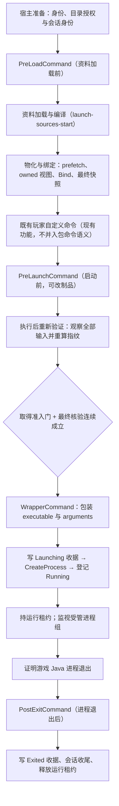

# MMC 二期命令能力阶段契约

状态：**二期核心实现与 Main 启动链接线已落地**（基于 [设计 7.1](mmc-instance-design.md#71-cfg-的有效行为能力表)）。
基线：分支 `codex/mmc-compatibility`（PR #23 `cb1776a5` 及后续收口补齐与导出/准入/引号修正）。范围见[二期待办](mmc-phase2-todo.md)。
本文档记录冻结契约与代码落地现状；`MmcConfigurationReader` 已按第 8 节判定表放行已实现并经验证的二期能力（`OverrideEnv/Env`、`PreLoadCommand`/`PreLaunchCommand`/`PostExitCommand`、`WrapperCommand`），仍未实现或明确排除的能力继续拒绝。

## 0. 范围、非目标与依据约定

| 项 | 内容 | 依据 |
| --- | --- | --- |
| 冻结对象 | 资料加载前 / 启动前 / Java 包装 / 进程退出后四阶段；GameRoot 工作目录；INST_DIR、INST_MC_DIR；子进程所有权；取消收尾；允许的派生输出；执行后重新验证 | 设计 L337 |
| 本文档覆盖 | 包内命令（PreLoad/PreLaunch/PostExit）与 Wrapper 进程所有权；Env、console／PermGen 只在交叉处点到 | 待办 L9-16；设计 L333-335 |
| 非目标 | 不把 cfg `WrapperCommand` 当作 ForgeWrapper／PCL JavaWrapper 已支持；不承诺技术上阻止任意外部进程写入 | 设计 L337、L347、L439 |
| 依据格式 | 每条契约标注「文档行号」或 `文件:行`；无依据处标 **待定 Dx**，见第 10 节 | 本任务硬性要求 |
| 语义纪律 | 未知编码或无法兑现的要求明确拒绝；不静默丢弃、不凭字段名猜语义 | 设计 L317、L325、L337；兼容范围 L17-18 |
| 冻结轮次 | 第一轮冻结契约并把 15 项列为待定；第二轮用仓库自身先例定掉 11 项（D1–D5、D7–D11、D14）；后续工程落地收口了 D6、D12、D13、D15 及 D8 探测/终止超时边界（详见第 10.2 节与第 12 节） | 本任务第二轮及后续落地记录 |
| 行号约定 | 本文引用的 `文件:行` 含撰写时历史快照，随二期落地会漂移，因此**以引用的代码语义和符号为准**。查找方法：命令能力校验看 `MmcConfigurationReader.cs` 与 `MmcCommandReader.Validate`；未实现键拒绝看 `OverrideGameTime` / `OverrideNativeWorkarounds` 的 `Unsupported("cfg:" + key, ...)`；Env 解码看 `MmcEnvironmentReader`；阶段执行与包装进程树看 `MmcRuntimeCommandExecution`、`MmcRuntimeWrapperCommand`、`MmcSessionProcessTree`、`MmcLaunch.cs` | lead 验收裁定 R-4 |
| 实现进度 | 见第 12 节。能力放行已与对应实现及自动化回归（Migration / Runtime / Export / Native Facade）同步落地；外部真实游戏、真实第三方认证及非提权符号链接权限边界见第 12 节末尾 | 设计 L337、L620 |

## 1. 阶段契约：四阶段时机与插入点

### 1.1 阶段总序

### 1.2 逐阶段契约

| 阶段 | cfg 字段 | 精确触发时机 | 允许的插入点（现有文件:行） | 依据 |
| --- | --- | --- | --- | --- |
| 资料加载前 | `PreLoadCommand` | 在**本次启动的实例运行输入开始加载（`launch-sources-start`）之前**执行；执行完才进入来源加载、编译、prefetch、物化与绑定 | 必须晚于宿主准备（`MmcLaunch.cs:73-94`：路径解析、来源读取、偏好捕获、登录等待、Java 选择）与可选的变体采用（`MmcLaunch.cs:100-109`）；必须在 `PrepareLaunchAsync`（`MmcLaunch.cs:110`）与首个资料进度点 `MmcRuntimeLaunchBuilder`／backend 的 `launch-sources-start`（`MmcInstanceBackend.Launch.cs:32-33`）之前 | 设计 L337（阶段名）；待办 L9；**已定 D1** |
| 启动前 | `PreLaunchCommand` | 在物化、绑定、最终快照之后，**创建进程与写 Launching 收据之前**执行 | `MmcLaunch.cs:166`（`BuildAsync`）与 `MmcLaunch.cs:182`（`MmcSessions.Launch`）之间；进程创建点是 `MmcRuntimeLaunchContracts.cs:95 CreateStartInfo()` | 设计 L337（「PreLaunch 可能改变制品，执行后不能继续沿用旧指纹」）；待办 L10 |
| Java 包装 | `WrapperCommand` | 不改变阶段顺序，改变**最终命令行的组成**：包装程序构成入口，Java 为其子进程 | 最终 argv 装配点 `MmcRuntimeLaunchBuilder.cs:93-110`；进程创建 `MmcRuntimeLaunchContracts.cs:95-107`；可注入点 `PCLCS/Launch/LegacyLaunchHost.cs:73 StartProcess` | 设计 L337（与 ForgeWrapper／PCL JavaWrapper 是不同能力）；待办 L13-14 |
| 进程退出后 | `PostExitCommand` | 在**游戏 Java 进程被证明退出之后执行**：**写退出收据之后、会话收尾与释放运行租约之前**，并覆盖于既有退出监视重试循环内（不得在收据之前执行） | 退出确认 `MmcSessions.cs:106-119 CompleteOwnedExit`、`MmcLaunch.cs:283-300 MonitorExitAsync`；次序证据 `MmcLaunch.cs:288`（写收据）→ `289`（等待监视收尾）→ `290-292`（释放会话）；收尾点 `MmcSessionRuntimeDirectories.cs:83-85` | 设计 L337；待办 L14；设计 L465（运行租约持有到「必要退出收尾结束」）；**已定 D9** |

| 顺序硬约束 | 内容 | 依据 |
| --- | --- | --- |
| 阶段不可乱序 | 四阶段按上表固定顺序；任一阶段失败时的处置按第 7 节，不得跳过后继续下一阶段 | 设计 L337（四阶段定义） |
| 收据必须先于命令 | `Launching.record` 的 `RuntimeFingerprint` 就是本次启动采用的输入指纹，因此 PreLaunch 与执行后重验必须发生在写收据之前 | `MmcSessions.cs:44-47`、`MmcLaunch.cs:182`、设计 L467 |
| 最终核验连续性 | 「最终快照验证 → 实际制品核验 → CreateProcess → Running 登记」之间不得中途释放再检查 | 设计 L461 |
| 阶段顺序与既有命令步 | 既有玩家命令仍是 `MmcLaunch.cs:42` 的独立「执行自定义命令」步；包命令不得合并进该步 | 设计 L333；兼容范围 L49 |
| 玩家命令与包命令的次序 | **玩家命令在前、包阶段命令按四阶段插入**，两者来源可区分。仓库既有次序是「全局 `LaunchAdvanceRun` → 实例 `VersionAdvanceRun`」，即玩家侧命令先执行；包阶段命令不得改变或重排既有玩家命令 | `LegacyLaunchProcess.cs:33-34`（先 global 后 version）、`LegacyLaunchProcess.cs:16-20`；`MmcLaunchPreferences.cs:87-88`；**已定 D4** |
| 包命令的启用前提 | 格式档位不支持的包命令必须在导入期拒绝，宿主**绝不推断或执行未知命令** | `MmcLaunch.cs:130-131` 原文注释；设计 L333、L337 |
| 用户确认沿用既有形态 | 用户确认使用既有确认对话框先例，不新造确认机制（**确认粒度**仍见 D13） | `MmcLaunch.cs:28-30`（`ConfirmVariantAdoption` 经 `ModBase.RunInUiWait` + `ModMain.MyMsgBox`，含「取消」分支并抛 `OperationCanceledException`） |
| 不得走旧旁路 | 禁止把包内 `PreLaunchCommand` 写入 `VersionAdvanceRun`／Setup.ini 交给普通实例路径执行；禁止复用 `ArgumentReplace` 的 `{...}` 占位体系承载包命令 | 设计 L333；`ModpackInstallLocal.cs:56-64`；`LegacyLaunchProcess.cs:16-52`；`MmcLaunch.cs:128-142` |

### 1.3 命令执行方式、退出码与日志脱敏（由仓库自身先例定）

| 项 | 契约 | 依据 |
| --- | --- | --- |
| 执行宿主（**已定 D3，落地校准**） | 包命令通过 `cmd.exe` 的 `/d /s /c "<command>"` 边框执行（在 `MmcRuntimeCommandExecution.Start` 设置 `Arguments = "/d /s /c \"" + text + "\""`）；原因：Windows 下 .NET `ProcessStartInfo.ArgumentList` 会按 VC++ CRT 规则把命令内嵌 `"` 转义为 `\"`，而 `cmd.exe` 不会反转义 `\"`，会导致带引号可执行路径报错退出。`/d` 禁用 AutoRun、`/s` 仅剥离最外层一对引号并原样保留内部引号；仍**禁止**无 `/d /s` 与外层定界的松散 `/c "{cmd}"` 拼接 | `PCLCS/Launch/MmcRuntimeCommandExecution.cs`；对照禁止形式 `LegacyLaunchProcess.cs`；`MmcSessions.cs` |
| 为何不用旧形式 | 旧形式把命令拼进一个字符串并由 shell 再解析，引号/转义面不可控；旧路径同时是设计 L333 明令禁止包命令沿用的旁路 | 设计 L333；`LegacyLaunchProcess.cs:16-52` |
| 工作目录 | `WorkingDirectory = paths.GameRoot`；与受管先例及第 2 节一致 | `MmcLaunch.cs:134-135`；`MmcSessions.cs:124-126` |
| 启动即失败 | 进程无法创建（`Process.Start` 返回 null）→ 立即抛出，按第 7 节 F-05 处理 | `MmcLaunch.cs:137` |
| 非零退出码（**已定 D5**） | 按阶段区分：**PreLoad／PreLaunch 非零 → 拒绝启动**（两者都可能改变制品，须进入 F-06 的重新验证与拒绝路径）；**PostExit 非零 → 仅记录诊断**，不回滚已结束的会话、不重写退出收据 | 仓库两处先例都不检查退出码（`MmcLaunch.cs:137-140`、`LegacyLaunchProcess.cs:44-51`），故「仅告警」会与设计 L337「无法兑现的要求明确拒绝」冲突；阶段区分依据设计 L337、F-06、F-15 |
| 退出码记录 | 需要记录时使用现有退出码形态（十进制 + `0x` 十六进制） | `MmcLaunch.cs:247-248` |
| 等待策略 | 随命令记录决定是否阻塞等待；等待期间响应取消，不得无界阻塞 | `MmcLaunch.cs:138-140`；`MmcLaunchPreferences.cs:23`（`WaitForExit`） |
| 取消 | `Kill(entireProcessTree: true)`（整树终止，覆盖 cmd 及其派生子进程）；与第 4.2 节收尾一致 | `MmcLaunch.cs:140,220,224,232,239`；待办 L14 |
| 日志脱敏（**已定 D14**） | 沿用仓库既有脱敏先例（`FilterAccessToken` 形态）对命令文本做脱敏后才可入日志；**不得落展开后原文**；受管运行期的日志出口必须经过计划自身的脱敏函数 | `LegacyLaunchProcess.cs:27`（`host.FilterAccessToken(command, 'F')`）；`MmcRuntimeLaunchContracts.cs:108-111`（`Redact`）；`MmcLaunch.cs:217`（`LogRedactor: runtime.Redact`）；待办 L13；设计 L319 |
| 日志顺序 | 日志入队前完成脱敏，不得先记录后补救 | `mmc-development.md:106`（「日志入队前脱敏」） |

## 2. 工作目录契约

| 契约 | 取值 | 依据 |
| --- | --- | --- |
| 四阶段统一 cwd | `paths.GameRoot` = `InstanceRoot/Layout.GameRootLeaf`（叶名只允许已验证的 `minecraft` 或 `.minecraft`） | 设计 L337（要求冻结「GameRoot 工作目录」）、L225（「进程工作目录指向 GameRoot」）、L223；`MmcSessions.cs:124-126`（强制等于 GameRoot）；`MmcRuntimeLaunchContracts.cs:98` |
| 游戏进程 cwd 与 `-Duser.dir` | 同为 GameRoot；其他取值明确拒绝 | `MmcRuntimeLaunchBuilder.cs:70,76,247-254`（`MMC_RUNTIME_WORKING_DIRECTORY`） |
| 玩家手动命令 cwd | GameRoot（既有行为，保持） | `MmcLaunch.cs:135` |
| 相对路径解析 | 一律相对 cwd=GameRoot 解析为绝对路径；**不得**用 InstanceRoot 或版本根代替 | 设计 L225（「不能统一替换成版本根」） |
| 变量与路径角色的区分 | `$INST_DIR` → InstanceRoot；`$INST_MC_DIR` → GameRoot；两者不得混用 | 设计 L225；`MmcRuntimeLaunchBuilder.cs:166-167` |
| 目录角色校验 | 任何阶段的路径都要过 `EnsureNoLinks` 与角色检查；GameRoot 缺失即拒绝启动 | `MmcInstancePaths.cs:44-48,96-106`；`MmcSessions.cs:127-128` |
| 不变量 | 命令不得被理解为「工作目录=版本根」；`minecraft/libraries` 与 `libraries` 仍是两个角色 | 设计 L225、L382；兼容范围 L39-40 |

## 3. 变量与展开契约

| 契约 | 内容 | 依据 |
| --- | --- | --- |
| 变量集合 | 复用运行期变量字典：`profile_name`、`version_name`、`version_type`、`game_directory`、`instance_directory`、`INST_DIR`、`INST_MC_DIR`、`assets_root`、`assets_index_name`、`game_assets`、`library_directory`／`libraries_directory`、`natives_directory`、`classpath`、`classpath_separator`、`primary_jar`、`launcher_name`、`launcher_version`、`resolution_width`／`resolution_height`、`mmc_logging_config` | `MmcRuntimeLaunchBuilder.cs:160-179` |
| 凭据变量 | 包内命令**不得**绑定 `auth_*`、`access_token`、`auth_session`、`user_type`、`user_properties`、`auth_xuid`、`clientid`、`client_token`；出现即按无法兑现拒绝 | 设计 L319（登录信息临时绑定、不进入持久化计划或证明日志）、L337；该禁令是否也适用于玩家手动命令见 **待定 D12** |
| 写法 | 同时接受 `${name}` 与裸 `$INST_DIR`／`$INST_MC_DIR`（后两者有单词边界判定）；`$` 后无匹配键时按字面 `$` 输出 | `MmcRuntimeLaunchBuilder.cs:187-196` |
| 展开时机（**含已定 D2**） | 只在「该阶段即将执行之前」、以本次启动已冻结的快照做一次展开；展开结果不写回定义、不参与指纹。**准入门关系**：命令在准入门**外**执行，执行完成后重新取门并做一次完整最终核验；不得在持门状态下执行外部命令（避免长命令阻塞准入门、避免自锁） | 设计 L378、L386（先算键再映射路径）、L461（只要求「最终核验→CreateProcess→Running 登记」连续）、L445（不得持准入门等待运行/退出）；仓库先例 `MmcLaunch.cs:42`（「执行自定义命令」是独立步，位于 `Start` 步之外）与 `MmcLaunch.cs:162`（准入门只在 `Start` 步内获取）；`MmcRuntimeLaunchBuilder.cs:180-208`；**已定 D2** |
| 未定义变量 | 明确失败（`MMC_RUNTIME_VARIABLE`），不得静默替换为空串 | `MmcRuntimeLaunchBuilder.cs:197`；设计 L337 |
| 非法字符 | NUL 出现在模板或展开结果即失败 | `MmcRuntimeLaunchBuilder.cs:181,201` |
| 长度预算 | 命令字符串沿用既有实例命令上限（16384 字符、禁 NUL）；包装后的命令行仍须满足 32767 上限 | `MmcLaunchPreferences.cs:92`；`MmcRuntimeWindowsCommandLine.cs:11-36`（`MMC_RUNTIME_COMMAND_LENGTH`） |
| 与 `+jvmArgs` 的区别 | `+jvmArgs` 数组每个元素就是**一个参数**，含空格不再切分；不得把命令文本按该语义并入 argv | 设计 L306、L321；兼容范围 L27 |
| 与 `minecraftArguments` 的区别 | `minecraftArguments` 用固定 prism-v1 的字面空格拆分；命令字符串**不是**启动参数串，必须作为命令文本另行解析 | 兼容范围 L26；设计 L321 |
| 与 cfg `JvmArgs` 的区别 | cfg `JvmArgs` 走相应格式的命令字符串解析后产出 JVM 参数；包命令产出的是一次外部执行，两者不得互相转换 | 设计 L321；待办 L12 |
| 允许的分词器 | 命令字符串若需要 token，只能使用命令串分词器 | `MmcArgumentTokenizer.cs:7`（注释明确：native minecraftArguments 与 `+jvmArgs` 成员永不经过该解析器） |
| 展开与 token 的次序 | 先展开变量，再按所选执行方式（shell 或 argv）处理；**只做一次**平台转义，且只发生在最终进程边界 | 设计 L321（「宿主仅在最终进程边界进行一次平台转义」） |
| 禁混用清单 | 不得经过旧 `SplitJavaArguments`／`DeduplicateJavaArguments`；不得经过 `ModMain.ArgumentReplace`；不得写入 `VersionAdvanceRun` | 设计 L319、L333；`ModMain.cs:323-326`；`LegacyLaunchProcess.cs:16-52` |

### 3.1 阶段与变量面的对应（lead 裁定 R-6 落地）

`PreLoadCommand` 在本次启动加载任何实例输入之前执行，因此运行期计划与物化结果都还不存在。
下表按「该阶段是否具备取值来源」划分变量面；分界依据 `PCLCS/Launch/MmcRuntimeCommandExecution.cs`
的 `Variables`（根变量）与 `PCLCS/Launch/MmcRuntimeLaunchBuilder.cs` 的 `CommandVariables`（plan 变量）。

| 类别 | 变量 | 依据 |
| --- | --- | --- |
| PreLoad 可用 | `game_directory`、`instance_directory`、`INST_DIR`、`INST_MC_DIR`、`launcher_name`、`launcher_version`、`resolution_width`、`resolution_height`、`classpath_separator` | 执行器根变量字典（正斜杠绝对形式） |
| 上下文有、变量面无 | `SessionId` | 上下文携带，但不进入变量字典；引用即按未知变量失败 |
| PreLoad 不可用（无条件） | `profile_name`、`version_name`、`version_type`、`assets_root`、`assets_index_name`、`game_assets`、`library_directory`、`libraries_directory`、`natives_directory`、`classpath` | 全部来自已编译 profile 与目录视图 |
| PreLoad 不可用（**有条件**） | `primary_jar`、`mmc_logging_config` | 需 MainJar 目标 / LoggingConfiguration 制品；即便到有计划阶段也不保证存在 |

「不可用」不是「留空」：引用即抛 `MMC_RUNTIME_VARIABLE` 并带键名，绝不替换为空串。

**同根结论（与 §3.2 同因，避免分别踩两次）**：PreLoad 位于计划与物化之前，因此
**plan 侧变量**与**本次会话可变目录**在该阶段同时不可得。两者处置一致 —— 明确失败或明确缺省，不猜测。
不得用宿主全局缓存目录冒充会话可变目录。

### 3.2 包 Env 对命令子进程的可见性（lead 裁定 D15 落地）

包声明的 `Env` 是该包的运行要求；命令与游戏同属其受管执行体，对命令不可见等于「要求无法兑现却静默」。
故按阶段区分：

| 阶段 | 是否继承 | 临时目录来源 |
| --- | --- | --- |
| `PreLoadCommand` | **不继承**，保持宿主基础环境 | **不存在**（会话可变目录在其后的 `BuildAsync` 内创建） |
| `PreLaunchCommand` | 继承 | 本次会话可变目录 |
| `PostExitCommand` | 继承 | 同上 |
| `WrapperCommand` | 不适用 | D11 已定不对包装子进程作技术强制声明 |

实现约束：复用 `MmcRuntimeEnvironmentOverlay.Apply`，保持其既有顺序（剥离执行输入通道 → 断言会话临时目录
→ 按源顺序叠加 → **再次断言**）。命令子进程的 `TEMP`／`TMP` 必须等于**本次会话可变目录**。

**断言口径**：`TEMP`／`TMP`／`JAVA_TOOL_OPTIONS`／`CLASSPATH` 被拒发生在**导入期**
（`MMC_CFG_ENV_RESERVED`），运行期 `Apply` 收到的是已净化映射。因此运行期断言的是
「叠加后 `TEMP`／`TMP` 仍等于传入的会话目录」（末次再断言生效，防大小写变体碰撞），
而不是「包想覆盖 TEMP 被拒」——那条路径到不了运行期。

**已知缺口（登记，需 owner 决定）**：PreLoad 阶段无合法临时目录实参。备选方案是把会话可变目录分配
提前到 PreLoad 之前，但那会改动「新鲜 owned 目录只创建一次」与失败回退的时序，属独立改动，不与本项混做。

## 4. 子进程所有权、取消收尾与退出判定

### 4.1 所有权

| 问题 | 契约 | 依据 |
| --- | --- | --- |
| 谁创建 | 宿主（LF）创建全部受管进程：包命令进程、包装程序、Java 游戏进程。Core 只出计划，不创建进程 | 设计 L28（宿主承担副作用执行）；`MmcRuntimeLaunchContracts.cs:63`（计划明确无 Start 方法） |
| 谁等待 | 宿主按阶段序列等待；等待策略随命令记录，不隐式后台化 | `MmcLaunch.cs:41-45`（阶段步）；`MmcLaunch.cs:138-140`（按 `WaitForExit` 阻塞）；`MmcLaunchPreferences.cs:23`（等待策略随命令记录） |
| 进程登记 | 受管进程必须登记 PID、创建时间、镜像身份；不得 `UseShellExecute`、不得用整串 `Arguments` | `MmcSessions.cs:54,123,129-139` |
| 凭证/nonce 保护 | 包与用户参数不能覆盖内部会话 nonce；nonce 由宿主注入 | `MmcSessions.cs:49,137`；设计 L467 |
| 包装程序的双重身份 | 包装模式下必须同时登记**入口进程**（包装程序）与**受管 Java 进程**；退出判定只认后者 | 待办 L13-14；`MmcSessions.cs:15`（现行注释：包装派生子进程需要另行验证的宿主支持） |
| 环境通道 | 受管 Java 进程必须继承已净化的环境：移除 `JAVA_TOOL_OPTIONS`／`JDK_JAVA_OPTIONS`／`_JAVA_OPTIONS`／`CLASSPATH`，`TEMP`／`TMP` 指向本次会话可变目录 | `MmcRuntimeLaunchContracts.cs:103-105`；核验方式 **已定 D11**，见下表 |
| Java 身份与 pin | 包装不得绕过 Java 身份核验与 Java pin；pin 覆盖 Launching／Running／退出收尾 | `MmcSessions.cs:35-38`；设计 L392 |

### 4.2 取消收尾顺序

| 步骤 | 动作 | 依据 |
| --- | --- | --- |
| 1 | 标记取消，阻止尚未开始的后续阶段；已开始的阶段保持既定处置 | `MmcLaunch.cs:130,220,229-235` |
| 2 | 终止**整个受管进程组**：包装程序与其 Java 子进程都必须在收尾范围内，不能只终止其中一个 | 待办 L14（「取消与退出确认覆盖整个受管理进程组」） |
| 3 | 终止原语沿用仓库既有形式：`Kill(entireProcessTree: true)` | `MmcLaunch.cs:140,220,224,232,239`；**已定 D8**（原语部分） |
| 4 | 终止后必须**证明**进程不存在，再进入收尾；不能以「已发出 Kill」代替证明 | 设计 L469；`MmcSessions.cs:111-115` |
| 5 | 存在不可证明的残留时保持 `Unknown`：保留会话收据与 Java pin，禁止自动删收据、禁止杀其他进程、禁止结构写入 | 设计 L469；`MmcSessions.cs:88,219` |
| 6 | 未写 `Launching.record` 的失败可退役本次新建的可变目录；已写收据只能走会话重放 | `MmcSessionRuntimeDirectories.cs:65-81`；`MmcLaunch.cs:193-202` |
| 7 | 有界等待（**已定 D8**，残项）：终止后进入有界等待并重试证明，候选 **3 秒**——取自仓库既有退出确认重试间隔；**未运行状态探测的超时上限仍需定值**（无仓库先例，不自行发明） | 3 秒依据 `MmcLaunch.cs:297`（`Task.Delay(3000)`）；`MmcLaunch.cs:239`（100ms 级轮询只用于已可判定状态）；上限 **待定 D8-残余** |

### 4.3 「包装程序先退出 ≠ 游戏已退出」判定表

判定要素来自现有保守进程观察契约与崩溃恢复要求：只有「受管 Java 进程被证明已退出」才能判退出，包装程序的自身状态不构成退出证据。

| 观察 | 判定 | 允许动作 | 依据 |
| --- | --- | --- | --- |
| 入口进程（包装程序）已退出，携带本次 nonce 的 Java 进程**被证明仍存活** | 会话仍运行 | 不得写 `Exited.record`、不得释放运行租约；只记录一条诊断 | 待办 L14；`MmcSessions.cs:177-181`；设计 L467 |
| 入口进程已退出，Java 进程**被证明不存在或从未产生** | 已退出 | 允许写退出收据并进入 PostExit 与收尾 | `MmcSessions.cs:81-92`；设计 L469 |
| 入口进程存活但镜像身份/创建时间与登记不符（含 PID 重用） | 待确认 `Unknown` | 保持只读待确认，禁止当作已退出 | `MmcSessionContracts.cs:54-65` |
| 非本次会话的 Java 进程存在（身份或 nonce 不符） | 与本次会话无关 | 不得当作游戏进程，也不得终止 | 设计 L469（禁止杀其他进程） |
| 无法读取进程信息（无权限、身份不符） | 待确认 `Unknown` | 保持只读待确认 | `MmcSessionContracts.cs:66-67`；设计 L469 |

判定所依据的可观察量（必须全部核对，不能只看 PID）：

| 要素 | 用途 | 依据 |
| --- | --- | --- |
| 进程镜像 SHA256 等于所选 Java 身份 | 排除「另一个 java.exe」 | `MmcSessions.cs:52-53,96-104`；设计 L469 |
| 登记创建时间一致 | 排除 PID 重用 | `MmcSessions.cs:54,112`；设计 L469 |
| 命令行含本次会话 nonce（仅内存匹配，不落日志） | 证明是本次受管 Java 进程 | `MmcSessionContracts.cs:65`；设计 L467、L469 |
| 受管进程组内无其他存活成员 | 覆盖包装程序的派生进程 | 待办 L14 |
| 退出收据 `Proof` 取值（**已定 D7**） | 已定：需要**新增一个证明来源值**（如 `WrapperManagedExit`），理由（a）现有枚举 `OwnedProcessHandleExited` 语义等于「进程句柄本身退出」，包装模式下先退出的恰是包装程序，直接沿用会**在语义上把「包装先退出」当成游戏已退出**，与待办 L14 冲突；（b）`TrustedHostProcessObservation` 是「宿主受控检查本用户进程」的保守观察，不等价于本会话的**句柄级**退出证明。新增值仍需同时登记**两个进程身份**（包装入口 + 受管 Java） | `MmcSessions.cs:177-185`（`WriteExit`／`ValidateExit` 的封闭枚举）、`MmcSessions.cs:106-119`（句柄级证明路径）、`MmcSessionContracts.cs:29-30`（登记记录只有一个进程字段）；待办 L14；设计 L469 |

**D11【已定】包装链环境净化的核验边界**：`CreateStartInfo` 只清理继承环境；对包装程序的子进程**不做也不声称技术强制**。因此包装模式下「子进程环境未被观察」按第 7 节 F-08 处理；`TEMP`／`TMP` 指向本次会话可变目录的保证仅覆盖受管入口进程。核验范围与拒绝条件仍属实现期 fixture 内容。

## 5. 允许的派生输出契约

| 位置 | 命令可否写入 | 说明 | 依据 |
| --- | --- | --- | --- |
| GameRoot 内玩家/游戏数据（mods、config、logs、saves、resources 等） | 允许 | 与普通游戏写入同一角色；仍受活动会话结构写门禁约束 | 设计 L225、L463；`MmcInstancePaths.cs:62-66` |
| `PCL/MmcRuntime/<viewKey>/**`（已校验输入视图、native、assets、support） | **禁止** | 活动期间禁止重建/覆盖/清理该视图；Wrapper 可变生成输出必须放独立 owned 目录 | 设计 L382、L384 |
| `libraries/**`（InstanceLocal 平面库）与共享来源副本 | **禁止** | 运行租约保护；不符已锁定摘要只能重试来源或拒绝，不能原地更新 AdoptedSha256 | 设计 L382 |
| `PCL/MmcArtifacts/sha256/**`（不可重取原件对象库） | **禁止** | 原件是持久环境，不属于 Derived，不随 Derived 清理 | 设计 L370、L518 |
| `PCL/InstanceDefinition.json`、`<实例名>.json`、来源快照、锁记录 | **禁止**（只能经结构事务） | 结构写必须确认没有活动/待确认会话，并走 Prepared→CommitDecided 事务 | 设计 L396、L423-428、L443 |
| `PCL/MmcSessions/**`、`PCL/MmcSessionHistory/**`、事务目录 | **禁止** | 收据与清理都由会话/事务身份授权 | `MmcSessions.cs:19-63,177-195`；`MmcSessionRuntimeDirectories.cs:83-118`；设计 L503 |
| 其他实例路径、全局共享 Maven 缓存、Java 安装目录 | **禁止** | 不把实例租约扩大成全局保护；也不得改写共享来源 | 设计 L463、L390、L497 |
| 命令自身声明的输出位置 | 允许，但必须登记 | 输出的实际路径与其**再次被读取的方式**要纳入计划与会话验收 | 设计 L384 |
| 已采用输入的原地改写 | **禁止** | 「物化后必须验证副本等于已锁定摘要，不符则重试来源/拒绝，不能原地更新 AdoptedSha256」 | 设计 L382 |
| 强制手段的现实边界 | 声明可信，不做技术阻止承诺 | 「不承诺阻止任意外部进程在 hash 检查与替换之间写入」；越界写入由第 6 节重验捕获并拒绝 | 设计 L439 |
| 派生输出的登记形态（**已定 D10**） | 已定：**不新增 `MmcDerivedOutputKind`**。第 6/7 节的重验不在定义里增加字段；命令产生的变化一律作为「违反已锁定摘要」被拒绝，合法改变必须走显式变体/修复/定义修改 → 新代数 → 重新物化 → 重建计划 | 设计 L378（采用新变体才产生新代数）、L382（不得原地更新 AdoptedSha256）、L337（重验规则与阶段契约同时冻结）；定义校验现有 4 类输出见 `MmcDerivedModels.cs:9-13`、`MmcDefinitionCodec.cs:306-350`；新增字段属格式级变更，本契约不据此修改冻结格式 |

## 6. 执行后重新验证契约

「PreLaunch 可能改变制品，执行后不能继续沿用旧指纹」是本节唯一的总纲；下表是它的可执行化。

| 项 | 契约 | 依据 |
| --- | --- | --- |
| 强制触发点 | PreLoad 与 PreLaunch 结束之后、以及「热缓存命中／同计划复用」路径，都必须重新观察一次全部输入，不得以缓存命中为由跳过 | 设计 L337；设计 L382（「运行前以及热缓存命中时核验的是实际 owned 副本」）；设计 L471（热计划命中仍须执行相同核验） |
| 重验时机（相对收据） | 必须在构造 `Launching.record` 之前完成，因为收据的 `RuntimeFingerprint` 即本次采用的输入指纹 | `MmcSessions.cs:44-47`；`MmcLaunch.cs:182`；设计 L467 |
| 重验时机（相对进程创建） | 重验与 CreateProcess、Running 登记之间连续持有准入门，中间不得释放再检查 | 设计 L461 |
| 重验范围 1：运行输入 | 全部 `artifact:*`、`derived:*`、`support:*`（owned）与 `java:*`（非 owned）观察项重算摘要与长度 | `MmcRuntimeLaunchBuilder.cs:38,44-48,53,125-137`；`MmcRuntimeFiles.cs:37-47`（`MMC_RUNTIME_INPUT_CHANGED`） |
| 重验范围 2：classpath 清单输入 | 清单内被锁定类的存在/缺失复检 | `MmcLaunch.cs:167,191`（`ObserveAsync`／`RevalidateManifestInputs`）；`MmcRuntimeLaunchBuilder.cs:92` |
| 重验范围 3：绑定启动文件与定义 | 已绑定启动文件（含 preserved、adopted、derived）逐字节核对；定义/代数/投影未变；无 pending、无活动会话 | `MmcInstanceBackend.Launch.cs:109-121,144-158`；`MmcSessions.cs:143-159` |
| 重验范围 4：可变目录所有权 | 会话可变目录路径与所有权标记仍属于本次会话 | `MmcRuntimeLaunchBuilder.cs:135,264-271`；`MmcSessionRuntimeDirectories.cs:55-62` |
| 重验范围 5：命令行 | 包装或命令导致的 argv 变化后重算 Windows 命令行长度（含 nonce 预留） | `MmcRuntimeLaunchBuilder.cs:113`；`MmcRuntimeWindowsCommandLine.cs:32-36` |
| 指纹重算 | 输入指纹必须用**重验后**的观察集合重算；不得沿用命令执行前的旧值 | `MmcRuntimeLaunchBuilder.cs:125-127`；设计 L337 |
| 摘要不符时的处置 | 明确拒绝本次启动；不得就地采纳当前字节、不得原地更新 AdoptedSha256 | 设计 L382；设计 L519 |
| 若 PreLaunch 合法需要改制品 | 只能走「显式变体采用／修复或定义修改 → 新代数 → 重新物化 → 重新生成最终启动计划 → 再取最终准入」的路径，且必须在该结构事务完成后再重新解析新代数 | 设计 L378；设计 L423-428；设计 L461 |
| 失败回退：未写收据 | 不创建进程；退役本次新建的可变目录；定义与来源不动；允许修复后重试 | `MmcLaunch.cs:193-202`；`MmcSessionRuntimeDirectories.cs:65-81` |
| 失败回退：已写收据 | 只能走会话重放；不可证明时保持只读待确认，禁止自动删收据或结构写入 | `MmcSessions.cs:72-94`；设计 L469 |
| 第三方内容介入 | 保留现场并进入 `RecoveryRequired`，不自动覆盖 | 设计 L425、L437 |

## 7. 失败与拒绝契约（失败模式表）

判定原则：**能力缺失、编码未知、要求无法兑现 → 拒绝启动；描述性差异、非活动值 → 仅告警或记录**。

| 编号 | 失败模式 | 处置 | 依据 |
| --- | --- | --- | --- |
| F-01 | cfg 无法完整解码（未知转义、未支持 list、QVariant、非法布尔、重复键、未知 ConfigVersion） | 拒绝（读取期即失败） | `MmcConfigurationReader.cs:43,63,73,94-97,128,144`；兼容范围 L17-18 |
| F-02 | 有效布尔/转义非法 | 拒绝，不得按 `false` 吞掉 | 设计 L325 |
| F-03 | 命令文本含 NUL 或超过长度上限 | 拒绝 | `MmcLaunchPreferences.cs:92`；`MmcRuntimeLaunchBuilder.cs:181` |
| F-04 | 命令引用未定义变量或凭据变量 | 拒绝（无法兑现） | `MmcRuntimeLaunchBuilder.cs:197`；设计 L319、L337 |
| F-05 | 命令无法创建（入口不存在、路径非法、非绝对、目录角色冲突） | 拒绝启动 | `MmcLaunch.cs:137`；`MmcInstancePaths.cs:74-86` |
| F-06 | PreLoad／PreLaunch 执行后输入摘要与已锁定值不符 | 拒绝启动，并要求显式修复／新代数 | 设计 L337、L382 |
| F-07 | 包装后命令行超过 32767 | 拒绝 | `MmcRuntimeWindowsCommandLine.cs:32-36` |
| F-08 | 包装程序身份/环境通道无法核验，导致 JVM 输入可能未被观察 | 拒绝（不得降级为「大概没问题」） | `MmcRuntimeLaunchContracts.cs:103-105`；同族拒绝见 `MmcRuntimeLaunchBuilder.cs:212-216`（`MMC_RUNTIME_UNBOUND_INPUT`）；设计 L337 |
| F-09 | 包装程序先退出但游戏未退出 | 不得判退出、不得收尾；记录诊断 | 待办 L14 |
| F-10 | 退出不可证明 | 保持 `Unknown`、保留收据与 pin、保持只读待确认 | 设计 L469；`MmcSessions.cs:88` |
| F-11 | 命令写入禁止位置 | 由第 6 节重验捕获→拒绝；不承诺技术阻止 | 设计 L439、L382 |
| F-12 | 会话可变目录清理遇到外部改动 | 保留所有权证据并报错，不继续清理 | `MmcSessionRuntimeDirectories.cs:116-117` |
| F-13 | 活动会话期间的结构写请求 | 直接拒绝（忙碌／入队），不得等待运行租约释放 | 设计 L443、L445 |
| F-14 | 命令非零退出码 | **已定 D5**：PreLoad／PreLaunch 非零 → 拒绝启动并进入 F-06 重验/拒绝路径；PostExit 非零 → 仅记录诊断 | 仓库两处先例均不检查退出码（`MmcLaunch.cs:137-140`、`LegacyLaunchProcess.cs:44-51`）；阶段区分见第 1.3 节；设计 L337 |
| F-15 | PostExit 自身失败 | 记录明确诊断，不回滚已结束的会话，不重写退出收据 | 设计 L465；`MmcSessions.cs:177-185` |
| F-16 | 用户手动命令与包命令同时非空 | **已定 D4**：两套路径都执行、来源可区分；**玩家命令在前**，包阶段命令按四阶段插入 | `LegacyLaunchProcess.cs:33-34`（全局 → 实例）；设计 L333；兼容范围 L49 |
| F-17 | 命令文本进入日志 | **已定 D14**：入队前用既有脱敏形态（`FilterAccessToken` / 计划 `Redact`）处理，不得落展开后原文 | `LegacyLaunchProcess.cs:27`；`MmcRuntimeLaunchContracts.cs:108-111`；`MmcLaunch.cs:217`；`mmc-development.md:106` |

## 8. 能力门判定表（`MmcConfigurationReader` 现行态与边界）

现行行为：`OverrideEnv / Env` 与 `OverrideCommands`（及旧别名 `OverrideLaunchCmd`）下的四个阶段字段已接入解码与运行时执行，并在通过结构与预算校验后放行；值非法、未知编码、凭据变量绑定、保留环境变量重声明、以及 `OverrideGameTime` / `OverrideNativeWorkarounds` 继续按 Error（启用时）或 Warning（非活动源保留原值）拒绝。

| 字段／情形 | 现行 | 契约目标态 | 仍拒绝／限制的情形 | 依据 |
| --- | --- | --- | --- | --- |
| `PreLoadCommand` 非空且生效 | **已放行并接通** | 放行（进入资料加载前阶段；提前物化经链接校验的 `GameRoot`） | 值无法解码、含 NUL／超 `16384`、引用未定义或凭据变量、非零退出、未按 D13 确认；可移植导出显式拒绝 | `MmcConfigurationReader.cs`、`MmcCommandReader.cs`、`MmcLaunch.cs`、`MmcInstanceExportPreferences.cs` |
| `PreLaunchCommand` 非空且生效 | **已放行并接通** | 放行（准入门外执行 + 执行后重验指纹） | 同上，且执行后改变输入指纹即按 `MMC_RUNTIME_INPUT_CHANGED` 拒绝 | `MmcLaunch.cs`、`MmcRuntimeCommandExecution.cs` |
| `WrapperCommand` 非空且生效 | **已放行并接通** | 放行（包装入口，Java 为受管 Job 子进程） | F-07、F-08、无法验证入口／发现带 nonce Java 子进程、超出命令行预算、未确认或包含凭据变量；可移植导出显式拒绝 | `MmcRuntimeWrapperCommand.cs`、`MmcSessionProcessTree.cs`、`MmcSessions.cs` |
| `PostExitCommand` 非空且生效 | **已放行并接通** | 放行（`Exited.record` 持久化后、会话收尾前） | 值无法解码、包含凭据／未定义变量；非零退出仅记录诊断，不阻塞收尾 | `MmcLaunch.cs`（`MonitorExitAsync`）、`MmcRuntimeCommandExecution.cs` |
| `Override=false`（源中不生效） | 保留 + 不生效 | **保持**：仅保留原值，不触发执行，可移植导出保持不拒 | — | 设计 L333；`MmcProfileTests.cs` |
| `OverrideCommands` 与旧别名 `OverrideLaunchCmd` 同时存在 | 新键优先 + `MMC_CFG_ALIAS` 告警 | **保持** | 取值非法时按 F-02 拒绝 | 设计 L325；`MmcConfigurationReader.cs` |
| 判定次序 | 按有效覆写与继承决定 | **保持「先算 Override／继承后的有效行为，再判定能力」** | 不得静默丢弃；可移植导出拒绝主动包内命令与 `OverrideEnv/Env` | `MmcConfigurationReader.cs`、`MmcInstanceExportPreferences.cs` |
| `OverrideEnv`／`Env` | **已放行并接通（D15 分期）** | `PreLaunch`/`PostExit`/游戏继承并叠加会话 `TEMP`/`TMP`；`PreLoad` 保持宿主基础环境 | `@Variant`／未知编码、重复键、格式错误、重声明 `TEMP`/`TMP` 或执行通道变量拒绝；可移植导出拒绝 | `MmcEnvironmentReader.cs`、`MmcRuntimeEnvironmentOverlay.cs`、`MmcInstanceExportPreferences.cs` |
| `OverrideGameTime`／`OverrideNativeWorkarounds` | 拒绝 | **保持拒绝** | — | `MmcConfigurationReader.cs`；设计 L334 |
| `PermGen`、`OverrideConsole`／console 系列 | 保留原值 + 明确差异诊断 | **差异通知直达用户与导出调整清单**，不做等价替换 | — | `MmcDisplayDifference.cs`、`MmcInstances.cs`、`MmcInstanceExportPreferences.cs` |

## 9. 边界条件汇总表

| 边界 | 契约 | 依据 |
| --- | --- | --- |
| 中文路径、空格路径 | 必须可用；变量注入的是绝对路径（正斜杠 Java 形式） | `MmcRuntimeFiles.cs:16-23`；兼容范围 L31 |
| `INST_DIR` 与 `INST_MC_DIR` 同时出现 | 允许；分别指向 InstanceRoot 与 GameRoot | 设计 L225 |
| 两棵游戏树（`minecraft` 与 `.minecraft` 同时存在） | 只以选中的一棵为 GameRoot；未选树保留为独立角色，不并入、不作为活动 GameRoot | 设计 L223、L497 |
| `libraries/a.jar` 与 `minecraft/libraries/a.jar` 同名异内容 | 合法且必须同时正确解析 | 设计 L225；MMC-16（L641） |
| 同一实例并发会话 | 仅允许一个活动游戏会话；活动期间结构写、修复、组件修改、还原、改名、删除全部拒绝 | 设计 L463 |
| 宿主先死／CreateProcess 与 PID 登记之间崩溃 | 持久收据让合作写入者视为待确认；恢复需创建时间、Java 身份、会话 nonce；不得自动删收据或杀他人进程 | 设计 L469 |
| 宿主窗口隐藏/关闭 | 监视器后台保活；活动会话期间不支持真正结束监视器；不得偷改全局退出偏好 | 设计 L465 |
| 热计划命中 | 仍须执行相同准入与字节核验 | 设计 L461、L471 |
| 登录等待期间发生结构写 | 允许；但本次启动之后必须重新解析新代数，不得用旧 N 代数访问 N+1 字节 | 设计 L461 |
| 路径含 `=`（javaagent 分离符） | 受控执行域构造时明确拒绝 | `MmcSessionRuntimeDirectories.cs:29-32` |
| 原生加载器路径预算 | 受控可变目录必须满足 260 字符预算（含 128 后缀余量） | `MmcSessionRuntimeDirectories.cs:12-13,21-28` |
| 外部进程并发写入 | 只覆盖 LF 合作写入者，不承诺 CAS | 设计 L439 |
| 跨实例隔离 | 其他实例改写同坐标全局来源不得影响本实例已核验 owned 副本 | 设计 L463；MMC-21（L646） |

## 10. 待定项清单

### 10.1 第二轮已定项（11 项，已回填各章）

| 编号 | 结论 | 依据来源（仓库自身先例 / 文档行号） | 回填位置 |
| --- | --- | --- | --- |
| D1 | PreLoadCommand 边界：**launch-sources 之前**（`launch-sources-start` 进度点之前）；必须晚于宿主准备与可选变体采用 | `MmcLaunch.cs:73-94`（准备）、`100-109`（采用）、`110`（PrepareLaunchAsync）；`MmcInstanceBackend.Launch.cs:32-33`（首个资料进度点） | §1.2 |
| D2 | PreLaunch 与准入门：**门外执行 + 执行后重新取门做完整最终核验**（避免持门执行外部命令） | 设计 L461（只约束最终核验→CreateProcess→登记连续）、L445（不得持准入门等待运行）；仓库先例 `MmcLaunch.cs:42` 独立命令步在 `Start` 步外、`MmcLaunch.cs:162` 门只在 `Start` 步内获取 | §3、§6 |
| D3 | 执行宿主：**`cmd.exe` + `Arguments = "/d /s /c \"" + text + "\""`**（校准 .NET `ArgumentList` 会把命令内部 `"` CRT 转义为 `\"` 导致 `cmd.exe` 解析带引号路径失败的问题）；仍禁止无 `/d /s` 的松散 `/c "{cmd}"` 拼接 | `PCLCS/Launch/MmcRuntimeCommandExecution.cs`；对照禁止形式 `LegacyLaunchProcess.cs`；`MmcSessions.cs` | §1.3 |
| D4 | 次序：**玩家命令在前，包阶段命令按四阶段插入**；不重排既有玩家命令 | `LegacyLaunchProcess.cs:33-34`（global → version）、`16-20`；`MmcLaunchPreferences.cs:87-88` | §1.2、§7 F-16 |
| D5 | 退出码：**PreLoad／PreLaunch 非零 → 拒绝启动**（并入 F-06）；**PostExit 非零 → 仅记录诊断** | 两处先例均不检查退出码（`MmcLaunch.cs:137-140`、`LegacyLaunchProcess.cs:44-51`）；阶段区分依据设计 L337；退出码形态 `MmcLaunch.cs:247-248` | §1.3、§7 F-14 |
| D7 | 退出证明：**新增一个证明来源值**（如 `WrapperManagedExit`）并登记两个进程身份；不得沿用句柄级值或保守观察值 | `MmcSessions.cs:177-185`（封闭枚举）、`106-119`、`MmcSessionContracts.cs:29-30`；待办 L14；设计 L469 | §4.3 |
| D8 | 取消原语：**`Kill(entireProcessTree: true)` + 有界等待重试**，候选 3 秒取自仓库既有退出确认重试间隔；**未运行状态探测的超时上限仍待定**（D8-残余） | `MmcLaunch.cs:140,220,224,232,239,297` | §1.3、§4.2 步骤 3/7 |
| D9 | PostExit 位置：**写退出收据之后、会话收尾之前**执行，并覆盖于既有退出监视重试循环内 | `MmcLaunch.cs:288`（收据）→ `MmcLaunch.cs:289`（等待监视收尾）→ `290-292`（释放）；`MmcSessions.cs:106-118`（收据→收尾→归档）；设计 L465 | §1.2 |
| D10 | 派生输出：**不新增 `MmcDerivedOutputKind`**；命令改动一律按「违反已锁定摘要」拒绝，合法改变走显式采用 → 新代数 | 设计 L378、L382、L337；现有 4 类输出 `MmcDerivedModels.cs:9-13`；格式级新增不在本契约范围 | §5 |
| D11 | 环境净化核验边界：`CreateStartInfo` 只清理继承环境；**对包装子进程不做技术强制声明**，未观察即按 F-08 拒绝；`TEMP`/`TMP` 保证仅覆盖受管入口进程 | `MmcRuntimeLaunchContracts.cs:95-107`（`CreateStartInfo` 的可净化范围） | §4.1 + §4.3 附注 |
| D14 | 日志脱敏：**入队前**用既有脱敏形态（`FilterAccessToken`／计划 `Redact`）处理，**不得落展开后原文** | `LegacyLaunchProcess.cs:27`；`MmcRuntimeLaunchContracts.cs:108-111`；`MmcLaunch.cs:217`；`mmc-development.md:106`；待办 L13；设计 L319 | §1.3、§7 F-17 |

### 10.2 原待定项与实现期收口结论（5 项均已按实际实现固化）

| 编号 | 问题 | 固化实现结论 | 依据 |
| --- | --- | --- | --- |
| D6 | WrapperCommand 与 LF JavaWrapper 模式的组合 | **已实现（组合模式）**：外层包 wrapper 作为进程入口，内层 `JavaWrapper` 或 `DirectMain` 原样重放为其子参数 | `MmcRuntimeWrapperCommand.cs`；`2ae04748` |
| D12 | 凭据变量在包命令中的处理 | **已实现（仅包内命令一律拒绝）**：`MmcCommandReader.Validate` 拒绝所有凭据变量（`MMC_CFG_COMMAND_CREDENTIAL`）；玩家手工自定义命令（`MmcLaunch.Custom`）保留原有 `ModMain.ArgumentReplace` | `MmcCommandReader.cs`、`MmcLaunch.cs` |
| D13 | 用户确认粒度与持久键 | **已实现（脱敏模板摘要指纹 `MmcPackageCommandConfirmed`）**：按生效的 `PreLoadCommand`／`PreLaunchCommand`／`PostExitCommand`／`WrapperCommand` 脱敏模板计算 SHA-256 指纹写入 `PCL\Setup.ini`，经 `MmcConfigurationCoordinator.Quiesce` 协调并发刷盘与启动准入；在 `PreLoad`、wrapper 激活启动与 `PostExit` 前 fail-closed 核验 | `MmcLaunchPreferences.cs`、`MmcLaunch.cs`、`MmcInstanceBackend.Launch.cs` |
| D15 | 包 Env 对命令子进程的可见性 | **已实现（按阶段区分）**：`PreLaunch`／`PostExit` 通过 `MmcRuntimeEnvironmentOverlay.Apply` 继承包 `Env` 与本次会话 `TemporaryDirectory`；`PreLoad` 不继承且 `TEMP`/`TMP` 保留宿主基础环境 | `MmcRuntimeCommandExecution.cs`、`MmcLaunch.cs`、§3.2 |
| D8-残余 | 取消／失败时进程树探测与等待预算 | **已实现（有界等待 + 只读 `Unknown` 保守阈值）**：命令/进程组取消宽限取既有 `3000 ms` 常量（`MmcRuntimeCommandExecution.CancellationGraceMilliseconds` / `MmcProcessTreeTermination.GraceMilliseconds`，`25 ms` 轮询）；`WrapperCommand` Java 子进程发现窗默认 `30 s`（`WrapperJavaDiscoveryTimeout`，钳制 `[100 ms, 300_000 ms]`）；启动失败但 Owned Job 组已确认清空时写 `WrapperManagedExit` 退出收据以便撤销，否则维持 `Unknown` 并保留 pin | `MmcSessionContracts.cs`、`MmcWrapperExit.cs`、`MmcSessions.cs`、`MmcLaunch.cs` |

## 11. 与验收矩阵的对齐

| 验收项 | 本文档对应条目 | 依据 |
| --- | --- | --- |
| MMC-20：OverrideCommands／旧别名、有效命令与 Wrapper 的拒绝与放行、数组参数单 token 与字符串解析、实际 argv | 第 1、3、7、8 节 | 设计 L645 |
| MMC-16：三根路径、变量与进程工作目录 | 第 2 节、第 9 节 | 设计 L641 |
| MMC-18：启动会话、收据崩溃点、活动游戏期间结构写拒绝 | 第 4、6 节 | 设计 L643 |
| MMC-21：Wrapper 等实际绑定 owned 副本、来源复制期间变化被摘要检查捕获 | 第 5、6 节 | 设计 L646 |
| P3 必测：收据各崩溃点、宿主关闭/强退、PID 重用、无法检查进程、退出收尾与新任务交错 | 第 4、6、7 节 | 设计 L471 |

**未验证声明**：本文档只冻结契约，不含任何实现或实测证据；第 8 节的目标态在对应实现与 fixture 落地前不得当作已放行能力，也不得据此宣称命令能力已接通。

## 12. 实现进度（按最新集成与实测更新）

本节记录契约各项的**落地状态**，不改变上文任何契约条目。**真实游戏及外部服务仍需实机另行验收，不得以自动化夹具代替。**

| 项 | 状态 | 提交／来源 | 验收证据与补充修补 |
| --- | --- | --- | --- |
| Env（`OverrideEnv`／`Env`） | **已接通并完成端到端 Main 接线** | `0a03ca0a` + PR #23 收口 | D15 阶段分化已接入真实 `MmcLaunch`：`PreLaunch`/`PostExit` 与 Java 继承包 `Env` 及会话 `TEMP`/`TMP`，`PreLoad` 保持宿主基础环境；主动 `OverrideEnv/Env` 在可移植导出中显式拒绝 |
| 包内命令三阶段（PreLoad／PreLaunch／PostExit） | **已接通并完成端到端 Main 接线** | `35d7c9f2` + PR #23 收口 | D13 模板指纹确认 `MmcPackageCommandConfirmed` 已接通 `ConfirmPackageCommands`、`Quiesce` 并发防撞与 `EnsureGameRootDirectory` 物化；`MmcRuntimeCommandExecution` 修复 Windows `cmd.exe /d /s /c "<command>"` 引号转义问题；主动包内命令在可移植导出中显式拒绝 |
| `WrapperCommand` | **已接通真实启动链并完成 Main 宿主验证** | `2ae04748` + `cb1776a5` + 收口补齐 | `MmcSessionProcessTree`（无 `KILL_ON_JOB_CLOSE` 的 Owned Job Object + `CREATE_SUSPENDED` 核验 + `PROC_THREAD_ATTRIBUTE_HANDLE_LIST` 继承匿名管道）、`NtQueryInformationProcess` nonce 发现受管 Java 子进程、双身份登记、`WrapperManagedExit`（含失败且 Job 已清空时的退出收据回写）、`LegacyWatcher` / `ModWatcher` 管道流与退出前日志脱敏全部接入并经 `mmc-phase2-launch` 覆盖；窗口监控按已发现的受管 Java PID 与 `HasGroupExited` 工作 |
| console／PermGen 与差异消费 | **已接通（通用诊断分级直达用户）** | `f5147d0e` + 收口补齐 | `MmcInstances.cs` 按诊断级别分发：`Severity >= Warning` 经 `ModMain.Hint`（`Blue`）提示用户，`Information` 记入 `Logger.Info`；不再仅靠少数硬编码 code 白名单消费；可移植导出已封口 |

**复跑环境前提（2026-11-12 实测）**：若在限制 `File.Replace` 的受限沙箱中运行 `mmc-configuration`，会遇到非产品缺陷的 `UnauthorizedAccessException`；生产与常规本地测试中保持 `File.Replace` 原子替换写入以确保崩溃一致性。

**第 12 节历史缺口收敛状态（2026-11-13 更新）**：
1. **PreLoad 输入面**：保持仅向 `PreLoad` 暴露启动前根变量（`$INST_DIR` / `$INST_MC_DIR` / `INST_ID` / `INST_NAME` 等），不存在运行期 `TemporaryDirectory` 与 plan 变量，并在 `PreLoad` 前完成经链接校验的 `GameRoot` 目录物化。
2. **wrapper argv 分词**：已按「先分词、后逐 token 展开」在 `MmcRuntimeWrapperCommand` 落地并有测试覆盖。
3. **差异诊断消费点（已关闭）**：`MmcInstances.cs` 现已将全部 `Severity >= Warning` 诊断通过 `ModMain.Hint` 呈现给用户、`Information` 记入 `Logger.Info`，`MMC_PACKAGE_JVM_UI_DIFFERENCE`、`MMC_DISPLAY_DIFFERENCE`、`MMC_PERMGEN_DIFFERENCE` 均可直达提示（`MMC_PACKAGE_PREFERENCE_RUNTIME` 作为 `Information` 记入日志）。
4. **4–6 号 Wrapper 启动链与 `WrapperManagedExit` 缺口（已关闭）**：PR #23 与后续补齐已完全接通真实 Main 宿主（`MmcLaunch.cs` -> `MmcSessions.Launch` -> `MmcSessionProcessTree`），覆盖早退 wrapper（`cmd /d /c start "" /b`）与长驻 wrapper（`cmd /d /c call`）取消、`WrapperManagedExit` 退出证明及失败清空后回收；本机已安装 JDK 8/17/21 且经 `PCLLF.Mmc.Runtime.Tests` 与 `PCLLF.Native.Facade.Tests` `--groups mmc-phase2-launch` 等实测通过。

**仍属外部/权限边界的待验证项**：外部真实作者整合包与 GTNH Java 17/25 游戏实机游玩、Authlib/Nide 真实外部账号与服务联调、真实界面视觉走查，以及无符号链接创建特权环境下由系统权限决定的符号链接测试用例（若未提权会失败，属于权限边界）。
